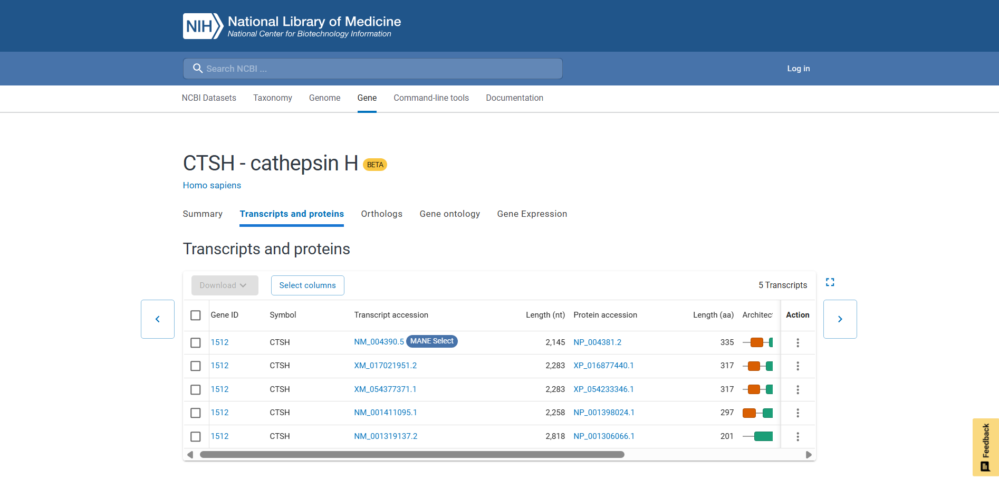
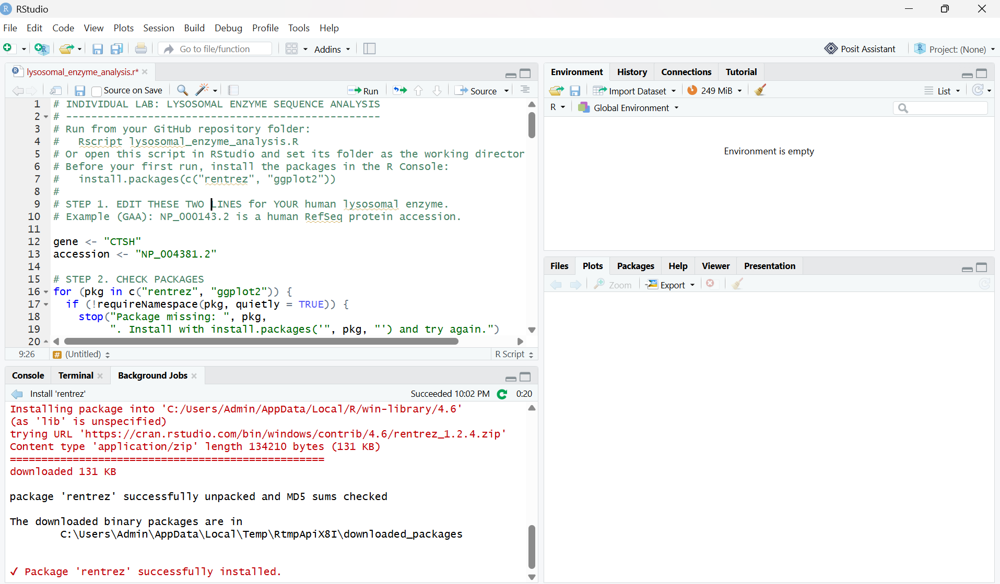
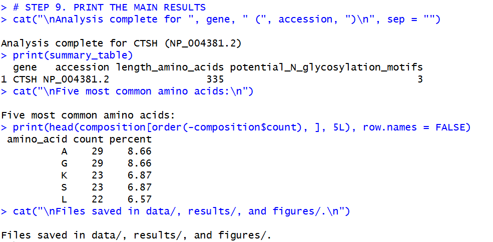
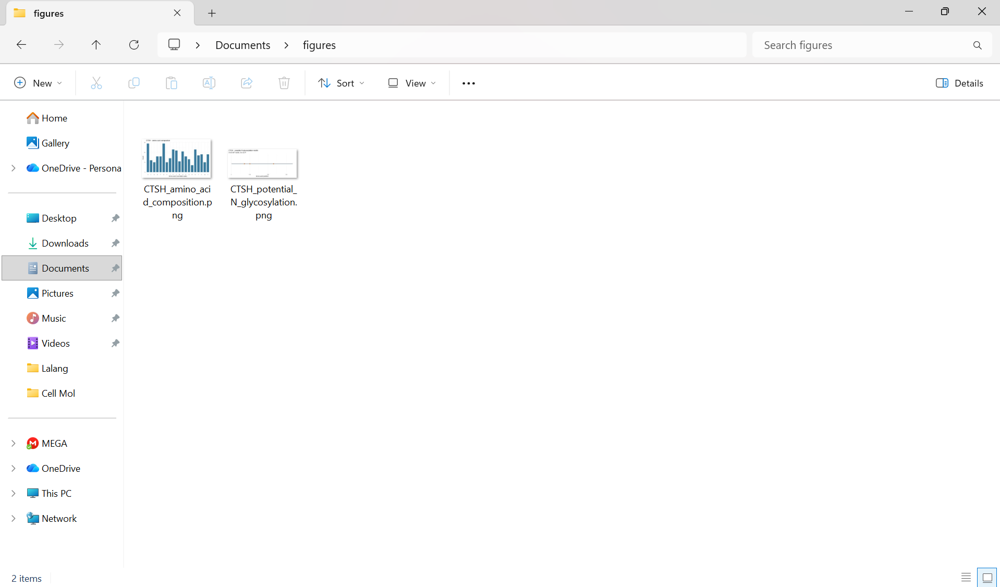
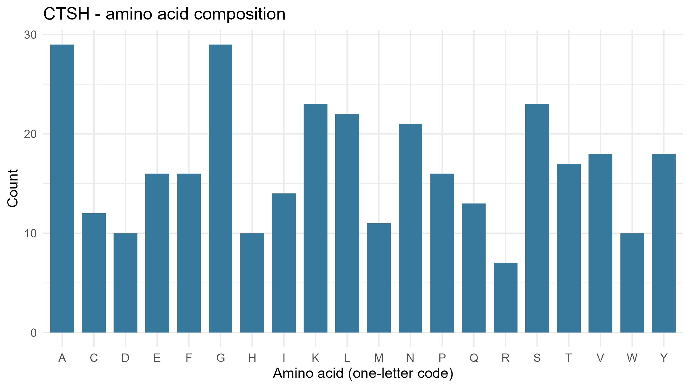
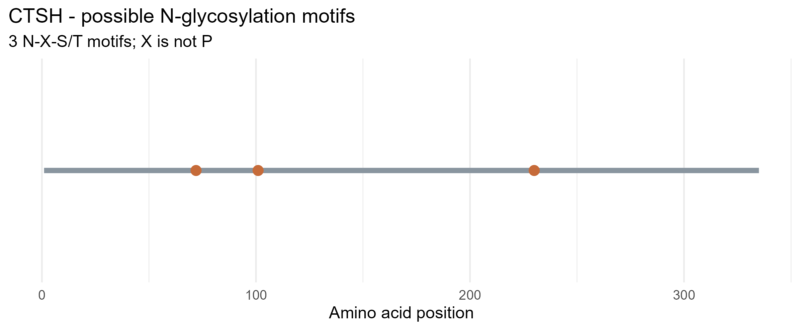

# Lysosomal Enzyme Analysis — CTSH

---

## PROJECT OVERVIEW
| Item | Details |
|---|---|
| **Enzyme** | Cathepsin H |
| **Gene Symbol** | CTSH |
| **NCBI Protein Accession** | NP_004381.2 |
| **Protein Name** | pro-cathepsin H |
| **Total Sequence Length** | 335 amino acids |
| **Accession Type:** | Full‑length human RefSeq protein (MANE Select) |
| **Analysis Date** | 14 October 2026 |

---

## Enzyme Function
CTSH (Cathepsin H) is a lysosomal cysteine protease of the papain family. It acts as both an **endopeptidase** (cleaves within protein chains) and an **aminopeptidase** (removes amino acids from the N‑terminus). It degrades proteins and peptides inside the lysosome, recycles amino acids, processes antigens for immune presentation, matures prohormones and proenzymes, and supports normal tissue remodeling.

---

## STEP-BY-STEP WORKFLOW

### STEP 1 — Obtain the Protein Sequence from NCBI
**What I did:**
- Visited NCBI Gene → searched for gene symbol: **CTSH**
- Navigated to "Transcripts and proteins" tab
- Selected the MANE Select RefSeq protein record: **NP_004381.2**
- Verified: Full-length human sequence, 335 amino acids



  ### STEP 2 — Set Up the R Script
**What I did:**
- Created project folder: `lysosomal-enzyme-CTSH/`
- Saved the analysis script as: `lysosomal_enzyme_analysis.R`
- Edited ONLY the first two lines to match my enzyme:

```r
gene <- "CTSH"
accession <- "NP_004381.2"

```
Then I installed the required packages in the console:

```r

install.packages(c("rentrez", "ggplot2"))

```
rentrez lets R pull data directly from NCBI — so the sequence is downloaded through the script and not just copied manually. ggplot2 is used to make the figures.



  ### STEP 3 — Run the Script & Check Results

  I ran the script using:
  ```r
source("lysosomal_enzyme_analysis.R")
```


**Results summary:**
- Protein length: 335 amino acids
- Potential N-glycosylation motifs found: 3
- Most common amino acids: Alanine (A) and Glycine (G) — 29 each at 8.66%, followed by Lysine (K), Serine (S), and Leucine (L)

Everything matched the accession length from NCBI, so I confirmed the download worked properly.

 ### STEP 4 — Folders Created
 After the script finished, these folders appeared in my project directory:
 

- `data/` - contains the FASTA sequence from NCBI
- `results/` - CSV files with counts, summary, and motif positions
- `figures/` - charts and plots

All files were generated automatically by the script.

### Step 5 — Generated Figures

I opened the `figures/` folder and confirmed both image files were created:



## Results & Figures

### Figure 1 — Amino Acid Composition


### Figure 2 — Potential N‑Glycosylation Motif Positions


---

## Answers to Lab Questions

### 1. What does your enzyme normally break down inside lysosomes?
CTSH (cathepsin H) breaks down proteins and peptides inside the lysosome. It works in two ways. As an aminopeptidase, it takes amino acids off the N-terminal end of a peptide one at a time. As an endopeptidase, it cuts inside a protein chain, though this is the lesser role. The leftover pieces are small peptides and free amino acids that the cell can reuse.

### 2. What is the total length of your protein, and which amino acids are most common?
The protein is 335 amino acids long. The most common amino acids are alanine (A) and glycine (G), 29 each (8.66%). Lysine (K) and serine (S) follow with 23 each (6.87%), then leucine (L) with 22 (6.57%). The full table is in  `results/CTSH_amino_acid_counts.csv `.

### 3. How many potential N‑glycosylation motifs did you find? Where are they located?
- **Motif definition:** N‑X‑S/T, where X ≠ Proline
- **Total found:** 3 potential N‑glycosylation sites
- **Positions & sequences:**
  - Position 72: N‑H‑T
  - Position 101: N‑C‑S
  - Position 230: N‑I‑T
- Full table: `results/CTSH_motif_positions.csv`

### 4. Why can glycosylation matter for lysosomal proteins? Does finding a motif prove the protein is glycosylated?
Lysosomal enzymes are made in the ER and Golgi, and many get sugar chains added there. These sugars can help the protein fold correctly and stay stable. In the Golgi, some of the sugars also get a mannose-6-phosphate tag, which is how the enzyme is sent to the lysosome instead of being secreted. Finding a motif does not prove the protein is glycosylated. The motif is only a sequence pattern. The site could be buried inside the folded protein or not reachable by the enzymes that add sugars. Lab methods like mass spectrometry would be needed to confirm it.

### 5. What could happen in the cell if your enzyme did not work properly?
Proteins in the lysosome would be broken down less efficiently, so undigested material could build up and the lysosome would not work as well. CTSH also helps process some other proteins, such as surfactant protein B in lung cells, so those pathways could be affected too. My analysis only looked at the sequence, so it can’t show how much activity is lost or what exactly would happen in a cell.

---

## References

- **NCBI Protein:** Cathepsin H — NP_004381.2. National Center for Biotechnology Information (2026).  
  https://www.ncbi.nlm.nih.gov/protein/NP_004381.2 — Accessed 14 Oct 2026
- **UniProt:** P09668 (CTSH). UniProt Consortium — https://www.uniprot.org/uniprotkb/P09668
- **R & Packages:** R Core Team (2024); `rentrez` (v1.2.3); `ggplot2` (Wickham, 2016)
- **Function:** CTSH = lysosomal cysteine protease — endopeptidase + aminopeptidase activity; protein turnover, immune processing, tissue remodeling

  ## Github URL: https://github.com/Jayeydd/lysosomal-enzyme-CTSH
